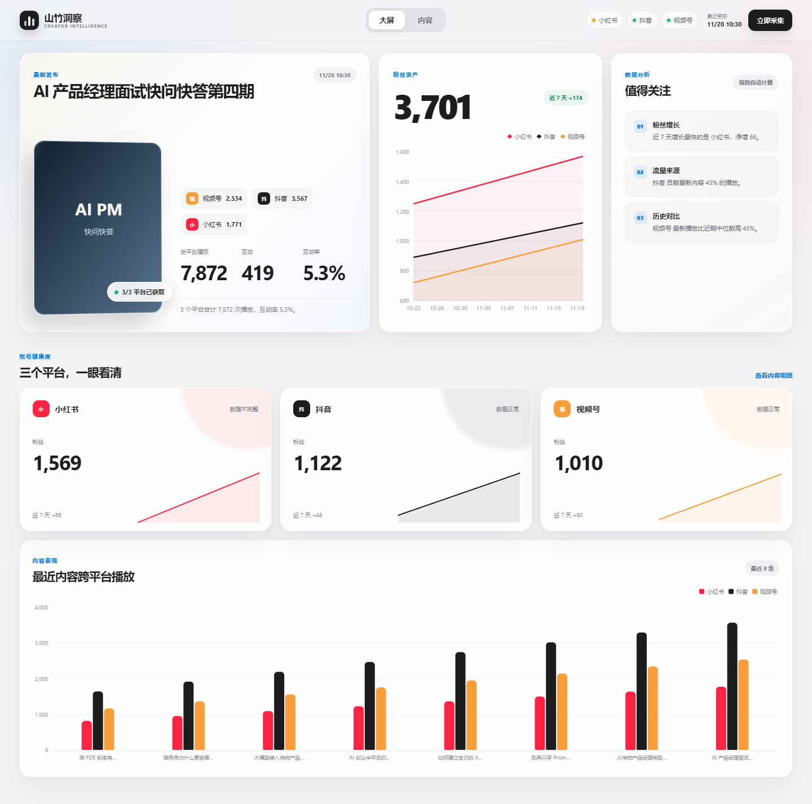

# 山竹洞察（ShanZhu Insight）

本地优先的创作者数据看板。定时采集自己的抖音、小红书、视频号创作者数据，再用两页高级看板展示。



## 功能

- 三个平台：抖音、小红书、视频号。
- 两个页面：总览大屏与内容档案。
- 本地 SQLite：账号、作品、每日快照、采集记录。
- 本地 ECharts：全平台粉丝资产趋势、单平台账号趋势与跨平台内容对比。
- 后台采集：看板运行时每 15 分钟自动采集，网页每 30 秒刷新状态。
- 登录管理：Cookie 失效会明确提示，也可主动更新三个平台的 Cookie。

不包含自动发布、竞品监控、云端同步、AI 分析和报警系统。

## 环境要求

- Windows 10 或 Windows 11。
- Node.js 22.5 或更高版本。
- 已安装 Google Chrome。
- 三个平台自己的创作者账号。

## 安装

```powershell
git clone https://github.com/CCCq-C/shanzhu-insight.git
cd shanzhu-insight
npm ci
```

启动看板：

```powershell
node src/cli.mjs serve
```

打开 [http://127.0.0.1:8789](http://127.0.0.1:8789)，在“账号健康度”卡片中分别登录抖音、小红书和视频号。只有主动登录时才显示 Chrome；采集始终在后台运行。

## 四个命令

```powershell
# 兼容入口：打开三个登录页并保存本地登录态
node src/cli.mjs login

# 检查三个平台的登录状态
node src/cli.mjs doctor

# 立即采集一次
node src/cli.mjs collect

# 启动本地看板
node src/cli.mjs serve
```

看板只监听 [http://127.0.0.1:8789](http://127.0.0.1:8789)，不会默认暴露到局域网或互联网。

## 自动采集

`serve` 运行期间，每 15 分钟自动采集一次。手动点击“立即采集”不会弹出 Chrome；网页内会显示当前状态。

如果不常驻运行看板，也可安装每天一次的兜底任务。不要同时把它当作主要采集方式。

默认每天 09:00 采集：

```powershell
powershell -ExecutionPolicy Bypass -File .\scripts\install-task.ps1
```

指定时间：

```powershell
powershell -ExecutionPolicy Bypass -File .\scripts\install-task.ps1 -At 18:30
```

移除定时任务：

```powershell
powershell -ExecutionPolicy Bypass -File .\scripts\uninstall-task.ps1
```

任务名固定为 `ShanZhuInsightDailyCollection`。采集使用无头 Chrome，不显示浏览器窗口。

## 数据获取方式

项目读取创作者后台页面已经返回的结构化响应，不抓页面上的文字顺序：

| 平台 | 数据入口 | 主要数据 |
| --- | --- | --- |
| 抖音 | 抖音创作者中心结构化接口 | 粉丝、作品、播放、赞、评、藏、分享 |
| 小红书 | 小红书创作服务平台结构化接口 | 粉丝、笔记、浏览、赞、评、藏、分享 |
| 视频号 | 视频号助手“单篇视频”和粉丝趋势响应 | 粉丝、作品、播放、赞、评、转发 |

内部接口可能变化。采集器最多保留 100 条近期作品。平台拒绝后续翻页时，已有首屏数据仍会保存，并在看板标记为“数据不完整”。

## 本地数据与备份

所有运行数据都在未跟踪的 `data/` 目录：

- `data/insight.db`：SQLite 数据库。
- `data/browser-profile/`：Chrome 登录态，包含敏感 Cookie。
- `data/covers/`：封面缓存。

备份前先停止看板与采集，再复制整个 `data/` 目录。恢复时放回项目根目录即可。

项目不保存接口原始响应。数据库只保存看板需要的账号公开指标、作品标识、标题、链接、封面地址和每日指标。

## 隐私与安全

- 不要提交、共享或同步 `data/browser-profile/`。
- 不要把 `8789` 端口直接暴露到互联网。
- 不要把个人 `data/` 目录打包进 GitHub Release。
- 只采集自己已登录账号的创作者后台数据。

## 已知限制

- 三个平台都没有为这组账号分析指标提供统一、稳定的公开 API。
- 小红书可能对后续分页返回 `HTTP 406`；此时只保存已取得页面并标记部分数据。
- 视频号需要页面成功切换到“单篇视频”后才会发出作品接口请求。
- 登录过期、滑块验证、平台改版会让当次采集显示“需要登录”或“采集失败”。

## 为什么现在没有浏览器插件

当前 Playwright 会话能直接捕获三个后台的结构化响应。浏览器插件不会增加数据完整性，反而增加安装、权限和维护成本。

只有平台以后把响应隔离到 Playwright 无法访问的上下文时，才启用 MV3 插件方案。插件也只申请对应创作者后台域名和最小网络权限。

## 排障

1. 看板显示“Cookie 已失效”时，点击对应平台的“重新登录”。
2. 运行一次 `node src/cli.mjs collect`，查看被清洗过的状态与警告。
3. 看板未自动更新时，确认 `node src/cli.mjs serve` 仍在运行。
4. 删除失效登录态前先备份 `data/`；不要直接删除数据库。

## 开发

```powershell
npm test
npm run check
```

许可证：MIT。第三方组件与行为参考见 [THIRD_PARTY_NOTICES.md](THIRD_PARTY_NOTICES.md)。
