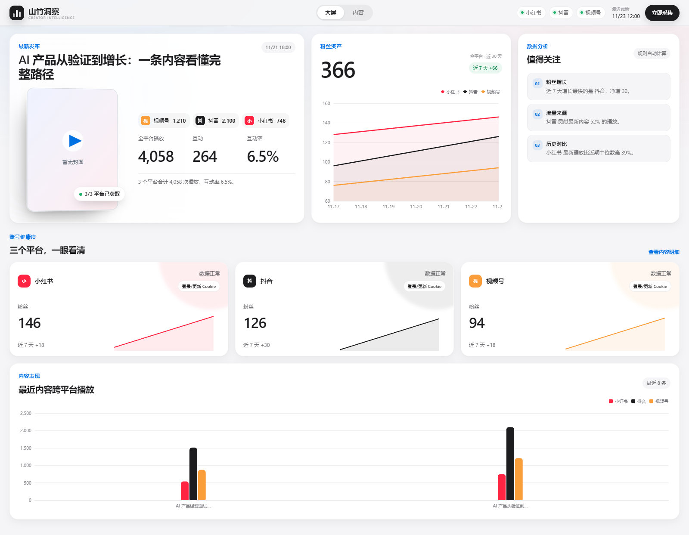
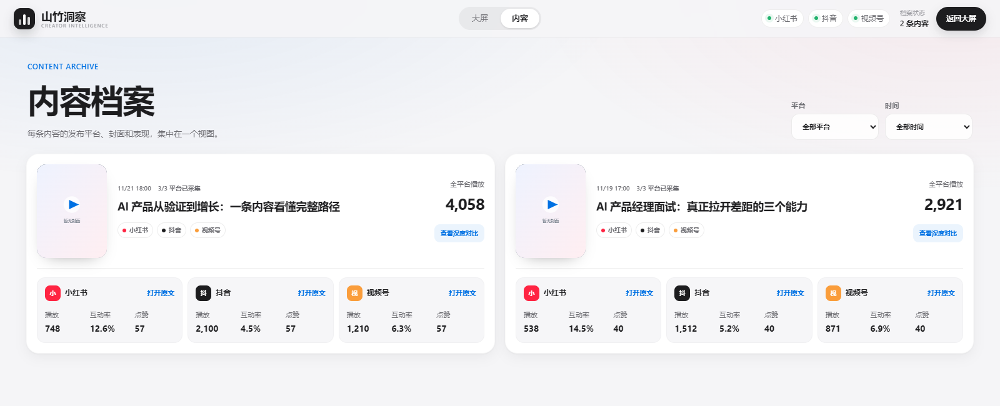
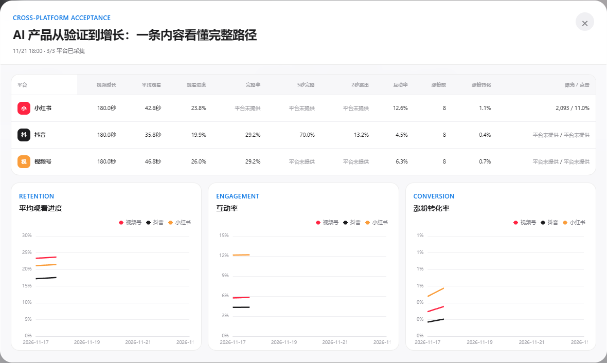
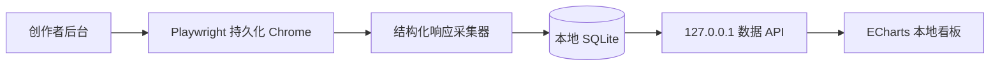

<div align="center">

# 山竹洞察

**一个本地优先的自媒体数据看板**

定时采集自己的抖音、小红书和视频号创作数据，在一个界面中对比粉丝增长、内容表现和深度指标。

[](LICENSE)


[3 分钟快速开始](#-快速开始) · [功能概览](#-功能概览) · [数据与隐私](#-数据与隐私) · [已知限制](#-已知限制)

</div>

## 界面预览

一屏查看跨平台内容表现、粉丝资产、账号健康度和近期趋势。以下界面全部使用脱敏演示数据。

<p align="center">
  
</p>

<p align="center">
  
  
  <br />
  <sub>内容档案 · 单条内容跨平台深度指标对比</sub>
</p>

## 为什么做山竹洞察

平台后台各自独立，同一条内容的播放、互动和粉丝转化很难横向比较。山竹洞察只解决一件事：

> 把三个创作者后台的数据放到一张好看、易读、可长期积累的本地看板里。

它不做自动发布，不托管账号，不上传 Cookie，也不依赖云端数据库。

## ✨ 功能概览

- **跨平台总览**：粉丝资产、近 30 天趋势、最新内容和跨平台播放对比。
- **内容档案**：将三个平台的同一条内容合并展示，无需逐个切换平台。
- **深度指标**：对比平均观看时长、完播率、跳出率、互动率和粉丝转化。
- **并行采集**：抖音、小红书、视频号同时采集，单平台失败不影响其他平台。
- **本地优先**：SQLite、Chrome 登录态和封面缓存全部保存在本机 `data/` 目录。
- **自动更新**：看板运行时每 15 分钟采集一次，也可手动立即刷新。

## 📊 支持的平台与数据

| 平台 | 账号数据 | 内容数据 | 深度数据 |
| --- | --- | --- | --- |
| 抖音 | 粉丝、关注、获赞、粉丝趋势 | 播放、赞、评、藏、分享 | 平均观看、5 秒完播、2 秒跳出、粉丝转化 |
| 小红书 | 粉丝、粉丝趋势 | 曝光、观看、赞、评、藏、分享 | 封面点击率、平均观看、涨粉 |
| 视频号 | 粉丝、粉丝趋势 | 播放、赞、评、转发 | 平均观看、完播率、涨粉 |

> 平台没有提供的指标会明确显示为“平台未提供”，不会使用 `0` 冒充。

## 🚀 快速开始

### 1. 环境要求

- Windows 10 或 Windows 11
- Node.js 22.5 或更高版本
- Google Chrome
- Git
- 自己的抖音、小红书和视频号创作者账号

### 2. 安装

```powershell
git clone https://github.com/CCCq-C/shanzhu-insight.git
cd shanzhu-insight
npm ci
```

### 3. 启动看板

```powershell
node src/cli.mjs serve
```

打开 [http://127.0.0.1:8789](http://127.0.0.1:8789)，在“账号健康度”区域分别登录三个平台。完成登录后，点击“立即采集”生成第一份数据。

- 只有需要登录时才显示 Chrome 窗口。
- 日常采集使用无头 Chrome，不占用前台。
- 第一次采集后，数据会在看板中自动刷新。

## 🧭 工作原理



项目使用创作者后台已经返回的结构化数据，不依赖页面文字排列。三个平台的网络请求并行执行，数据使用独立 SQLite 事务保存。

## ⌨️ 命令行

```powershell
# 打开三个平台的登录页
node src/cli.mjs login

# 检查登录状态
node src/cli.mjs doctor

# 立即采集一次
node src/cli.mjs collect

# 启动看板与 15 分钟定时采集
node src/cli.mjs serve
```

### Windows 每日兜底任务

如果不常驻运行看板，可安装每天一次的计划任务：

```powershell
# 默认每天 09:00
powershell -ExecutionPolicy Bypass -File .\scripts\install-task.ps1

# 指定时间
powershell -ExecutionPolicy Bypass -File .\scripts\install-task.ps1 -At 18:30

# 移除计划任务
powershell -ExecutionPolicy Bypass -File .\scripts\uninstall-task.ps1
```

任务名固定为 `ShanZhuInsightDailyCollection`。

## 🗂️ 数据与隐私

所有运行数据都保存在未跟踪的 `data/` 目录：

| 路径 | 内容 |
| --- | --- |
| `data/insight.db` | SQLite 数据库 |
| `data/browser-profile/` | Chrome 登录态，包含敏感 Cookie |
| `data/covers/` | 封面缓存 |

- 项目不会将 Cookie、数据库或原始接口响应上传给项目作者。
- 本地服务只监听 `127.0.0.1:8789`，请勿映射到局域网或公网。
- 备份前请停止看板，然后复制完整 `data/` 目录。
- 请勿将 `data/`、截图或浏览器配置打包到 GitHub Release。

### 切换账号

当前每个 `data/` 目录只支持每个平台一个账号。检测到同平台账号变化时，采集会停止，旧数据不会被覆盖或混合。

如需切换账号：

1. 停止山竹洞察。
2. 将现有 `data/` 重命名为账号专属备份，例如 `data-account-a/`。
3. 重新启动并登录新账号，程序会创建新的 `data/`。

恢复旧账号时，停止程序并换回对应目录。不要合并不同账号的数据库或浏览器配置。

## ⚠️ 已知限制

- 项目当前只支持 Windows 和本机 Google Chrome。
- 三个平台没有为这组数据提供统一、稳定的公开 API；平台改版可能导致采集器暂时失效。
- 默认采集最近 90 天、每个平台最多 100 条作品。
- 登录过期、滑块验证或平台风控会使当次采集失败。
- 项目不支持自动发布、云端同步、多用户、多账号或竞品监控。

## 🧪 开发与验证

```powershell
npm test
npm run check
```

测试覆盖采集解析、分页、数据库迁移、账号状态、封面安全、本地 API、后台任务和看板交互。

### 项目结构

```text
├── src/
│   ├── platforms/     # 三个平台的采集器
│   ├── web/           # 看板页面
│   ├── db.mjs         # SQLite 数据层
│   ├── server.mjs     # 本地 HTTP 服务
│   └── cli.mjs        # 命令行入口
├── scripts/            # Windows 计划任务
├── test/               # 自动化测试与示例数据
└── data/               # 本地运行数据，Git 已忽略
```

## 🤝 贡献

欢迎提交 [Issue](https://github.com/CCCq-C/shanzhu-insight/issues) 和 [Pull Request](https://github.com/CCCq-C/shanzhu-insight/pulls)。

1. Fork 仓库并创建功能分支。
2. 保持改动小而可验证。
3. 提交前运行 `npm test` 和 `npm run check`。
4. 不要提交 Cookie、真实接口响应、账号 ID 或未脱敏截图。

完整流程见 [CONTRIBUTING.md](CONTRIBUTING.md)。提交问题前请使用仓库的 Issue 模板；安全问题请按 [SECURITY.md](SECURITY.md) 私下报告。

## 📜 声明

本项目与抖音、小红书、微信视频号及其关联公司无官方关联。请仅采集自己有权访问的账号数据，并遵守对应平台的服务条款和所在地法律。

## 📄 许可证

项目使用 [MIT License](LICENSE)。第三方依赖与设计参考见 [THIRD_PARTY_NOTICES.md](THIRD_PARTY_NOTICES.md)。

## 💬 加入社群与商务合作

想加入山竹洞察使用交流群，可以扫码添加微信。企业定制、数据看板定制或商务合作，也可以通过同一微信联系。

添加时请备注：`山竹洞察社群`、`企业定制` 或 `商务合作`。

<p align="center">
  
  <br />
  <sub>加入社群 · 企业定制 · 商务合作</sub>
</p>
